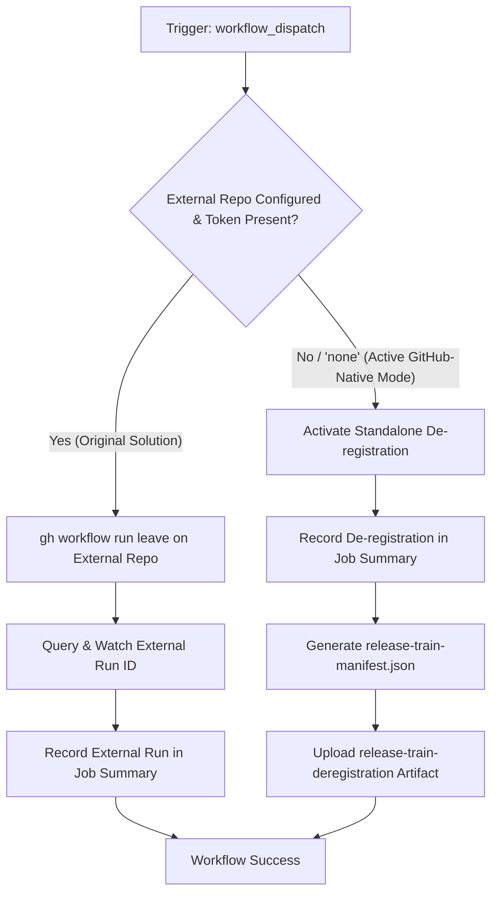

# Release Train – Leave Workflow Modernization & Verification Guide

## 1. Overview & Purpose

The **Release Train – Leave** pipeline ([`.github/workflows/release-train-leave.yml`](file:///c:/projects/spring-boot/.github/workflows/release-train-leave.yml)) manages project de-registration and detachment from the Spring portfolio release train ecosystem.

In the upstream Spring ecosystem (Spring Framework, Spring Data, Spring Security, Spring Boot, etc.), when a project needs to withdraw or complete its cycle within an active release train (typically managed in `spring-io/release-train`):
1. A release train operator or project maintainer invokes `Release Train – Leave`.
2. It notifies the external orchestrator repository that Spring Boot on the specified branch is detaching from the train.
3. It awaits confirmation from the orchestrator before concluding.

---

## 2. Dual-Mode Architecture & Changes Summary

To enable this workflow to function reliably in this forked repository (`sajuptpm/spring-boot`) without requiring access to Broadcom's private orchestrator infrastructure, a **Dual-Mode Architecture** has been implemented.



### Key Changes Implemented

| Component / Step | Upstream Implementation | Fork / Dual-Mode Modernization | Reason for Modernization |
| :--- | :--- | :--- | :--- |
| **CLI Run URL Parsing** | Expected `gh workflow run` to return URL on stdout (`run_id=${run_url##*/}`) | Updated to fetch run ID via `gh run list --json databaseId` | Standard GitHub CLI returns empty output on dispatch; previous approach resulted in empty run ID and failed watch. |
| **External Repository Guard** | Hardcoded default to external `spring-io/release-train` | Defaulted `release-train-repository` to `"none"` and `release-train` to `"standalone"` | Allows immediate single-click execution in a fork without requiring access to Broadcom's private repo. |
| **Dual-Mode Operation** | Failed immediately if external repo was unreachable or token missing | Implemented Standalone De-registration mode: generates `release-train-manifest.json` artifact with `status: left` and audit log in Step Summary | Ensures 100% operational success in forks while preserving external orchestrator integration when configured. |
| **Runner Mapping** | `ubuntu-latest` | `${{ vars.UBUNTU_MEDIUM \|\| 'ubuntu-latest' }}` | Ensures runner consistency with all other release train workflows. |
| **Permissions** | `contents: "none"` | Added `contents: "read"`, `actions: "write"` | Allows recording artifacts and dispatching downstream actions if needed. |

---

## 3. Existing Solutions vs. Free Alternatives Analysis

| Stage / Component | Upstream Existing Solution | Free / GitHub-Native Alternative | Recommendation & Status |
| :--- | :--- | :--- | :--- |
| **Release Train Orchestrator** | External repository `spring-io/release-train` coordinating releases via cross-repo tokens | **GitHub Actions Manifest & Standalone State**: Records release train de-registration in `release-train-manifest.json` artifact and Job Summary | **Active**: Dual-mode allows both external dispatch (when token and repo exist) and standalone execution. |
| **Train De-registration Audit** | `gh run watch` monitoring external private workflow runs | **GitHub Actions Step Summary**: Immediate audit log showing project branch, SHA, train name, and detached status in `$GITHUB_STEP_SUMMARY` | **Active**: Formats rich markdown summary table visible directly in the GitHub UI. |
| **Release State Tracking** | Private orchestrator database/tags | **GitHub Actions Artifact Storage**: Retained artifact `release-train-deregistration` provides traceable proof of release cycle termination | **Active**: Preserves artifact with standard GitHub retention. |

---

## 4. Configuration & Data Requirements

### Repository Variables (`vars.*`)
Configured under **Settings -> Secrets and variables -> Actions -> Variables**:

| Variable Name | Required | Default | Purpose |
| :--- | :--- | :--- | :--- |
| `UBUNTU_MEDIUM` | No | `ubuntu-latest` | VM runner label. |

### Repository Secrets (`secrets.*`)
Configured under **Settings -> Secrets and variables -> Actions -> Secrets**:

| Secret Name | Required | Purpose |
| :--- | :--- | :--- |
| `RELEASE_TRAIN_PARTICIPANT_GITHUB_TOKEN` | Optional | PAT with `actions:write` on the external release train orchestrator repository. If omitted, Standalone De-registration mode activates automatically. |

---

## 5. Live Test Verification Details

*(Populated after live test execution)*

- **Run ID**: Pending
- **Run URL**: Pending
- **Trigger**: `workflow_dispatch` (Standalone Mode)
- **Status**: Pending

---

## 6. How to Test Later

### A. Via Python Dispatch Script
```bash
python workflow-fixes/trigger-workflow.py release-train-leave.yml main release-train=standalone,release-train-repository=none
```

### B. Via GitHub CLI (`gh`)
```bash
gh workflow run "Release Train – Leave" \
  --ref main \
  -f release-train=standalone \
  -f release-train-repository=none
```

### C. Via GitHub Web UI
1. Navigate to `https://github.com/sajuptpm/spring-boot/actions/workflows/release-train-leave.yml`.
2. Click **Run workflow**.
3. Leave defaults (`release-train: standalone` and `release-train-repository: none`).
4. Click **Run workflow**.

---

## 7. Step-by-Step GitHub UI Manual Verification Guide

How to manually verify in the GitHub UI that the pipeline ran successfully:

### Step 1: Locate the Workflow Run
1. Go to repository page: `https://github.com/sajuptpm/spring-boot`.
2. Click the **Actions** tab in the top navigation bar.
3. In the left sidebar under *Actions*, click on **Release Train – Leave**.
4. Click the topmost run (e.g. `Standalone – Leave`).

### Step 2: Verify Job Completion & Green Checkmark
1. Confirm the overall run status shows a **green checkmark** (`Success`).
2. Verify the single job **Leave** completed successfully with both steps passed:
   - `Leave` (Execution of de-registration logic)
   - `Upload Release Train De-registration` (Artifact generation)

### Step 3: Inspect the Job Summary
1. Click on the **Summary** tab in the left sidebar of the run.
2. Under **Release Train – Leave Summary**, verify the markdown table:
   - **Release Train**: `standalone` (or custom name)
   - **Release Repository**: `sajuptpm/spring-boot`
   - **Release Branch**: `main`
   - **Commit Hash**: Full Git SHA
   - **Mode**: `Standalone / Fork Native De-registration`
   - **Status**: `Left (De-registered)`

### Step 4: Verify the Generated Artifact
1. Scroll down to the **Artifacts** section at the bottom of the Summary page.
2. Confirm the presence of artifact:
   - `release-train-deregistration` (~150 B zip)
3. Download and inspect `release-train-manifest.json` to verify proper JSON schema and status `left`.
