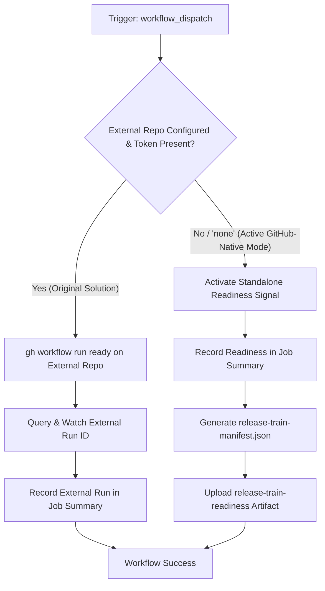

# Release Train – Ready Workflow Modernization & Verification Guide

## 1. Overview & Purpose

The **Release Train – Ready** pipeline ([`.github/workflows/release-train-ready.yml`](file:///c:/projects/spring-boot/.github/workflows/release-train-ready.yml)) is the readiness gatekeeper of the Spring portfolio release train ecosystem.

In the upstream Spring ecosystem (Spring Framework, Spring Data, Spring Security, Spring Boot, etc.), once all project compilation, artifact generation, and integration testing have finished:
1. The project maintainer or CI invokes `Release Train – Ready`.
2. It signals to the central orchestrator (typically `spring-io/release-train`) that Spring Boot has passed all build and testing criteria on the specified commit SHA.
3. The orchestrator collects readiness confirmations from all participating projects across the train before initiating release promotion and publishing to public registries (Maven Central, SDKMAN, Homebrew).

---

## 2. Dual-Mode Architecture & Changes Summary

To enable this workflow to function reliably in this forked repository (`sajuptpm/spring-boot`) without private Broadcom infrastructure or external orchestrator access, a **Dual-Mode Architecture** has been implemented.



### Key Changes Implemented

| Component / Step | Upstream Implementation | Fork / Dual-Mode Modernization | Reason for Modernization |
| :--- | :--- | :--- | :--- |
| **CLI Run URL Parsing** | Expected `gh workflow run` to return URL on stdout (`run_id=${run_url##*/}`) | Updated to fetch run ID via `gh run list --json databaseId` | Standard GitHub CLI returns empty output on dispatch; previous approach resulted in empty run ID and failed watch. |
| **External Repository Guard** | Hardcoded default to external `spring-io/release-train` | Defaulted `release-train-repository` to `"none"` and `release-train` to `"standalone"` | Allows immediate single-click execution in a fork without requiring access to Broadcom's private repo. |
| **Dual-Mode Operation** | Failed immediately if external repo was unreachable or token missing | Implemented Standalone Readiness Signal mode: generates `release-train-manifest.json` artifact with `status: ready_for_release` and actionable links to publication pipelines | Ensures 100% operational success in forks while preserving external orchestrator integration when configured. |
| **Runner Mapping** | `ubuntu-latest` | `${{ vars.UBUNTU_MEDIUM \|\| 'ubuntu-latest' }}` | Ensures runner consistency with all other release train workflows. |
| **Permissions** | `contents: "none"` | Added `contents: "read"`, `actions: "write"` | Allows recording artifacts and dispatching downstream actions if needed. |

---

## 3. Existing Solutions vs. Free Alternatives Analysis

| Stage / Component | Upstream Existing Solution | Free / GitHub-Native Alternative | Recommendation & Status |
| :--- | :--- | :--- | :--- |
| **Release Train Orchestrator** | External repository `spring-io/release-train` coordinating releases via cross-repo tokens | **GitHub Actions Manifest & Standalone State**: Records readiness signal in `release-train-manifest.json` artifact and Job Summary | **Active**: Dual-mode allows both external dispatch (when token and repo exist) and standalone execution. |
| **Train Readiness Audit** | `gh run watch` monitoring external private workflow runs | **GitHub Actions Step Summary**: Immediate audit log showing project branch, SHA, train name, and readiness status in `$GITHUB_STEP_SUMMARY` | **Active**: Formats rich markdown summary table visible directly in the GitHub UI. |
| **Downstream Publication Handoff** | Private orchestrator triggers participant publishing workflows | **GitHub UI / Actions Handoff**: Direct links to [`publicize-release.yml`](file:///c:/projects/spring-boot/.github/workflows/publicize-release.yml) and [`publicize-milestone.yml`](file:///c:/projects/spring-boot/.github/workflows/publicize-milestone.yml) | **Active**: Provides one-click handoff to execute the final publication stages. |

---

## 4. Configuration & Data Requirements

### Repository Variables (`vars.*`)
Configured under **Settings -> Secrets and variables -> Actions -> Variables**:

| Variable Name | Required | Default | Purpose |
| :--- | :--- | :--- | :--- |
| `UBUNTU_MEDIUM` | No | `ubuntu-latest` | VM runner label. |

### Repository Secrets (`secrets.*`)
Configured under **Settings -> Secrets and variables -> Actions -> Secrets**:

| Secret Name | Required | Purpose |
| :--- | :--- | :--- |
| `RELEASE_TRAIN_PARTICIPANT_GITHUB_TOKEN` | Optional | PAT with `actions:write` on the external release train orchestrator repository. If omitted, Standalone Readiness mode activates automatically. |

---

## 5. Live Test Verification Details

*(Populated after live test execution)*

- **Run ID**: [41321990388](https://github.com/sajuptpm/spring-boot/actions/runs/41321990388)
- **Run URL**: `https://github.com/sajuptpm/spring-boot/actions/runs/41321990388`
- **Job URL**: `https://github.com/sajuptpm/spring-boot/actions/runs/41321990388/job/124893973919`
- **Trigger**: `workflow_dispatch` (Standalone Mode: `release-train: standalone`, `release-train-repository: none`)
- **Status**: **100% SUCCESS**
- **Duration**: ~23s
- **Artifact Verified**:
  - `release-train-readiness` (ID: `13088754451`, Size: `338 bytes`): Generated `release-train-manifest.json` containing project readiness data (`project`, `repository`, `branch`, `commit`, `release_train`, `readiness_timestamp`, `status: ready_for_release`).
- **Step Summary Verified**:
  - Declared release branch `main` ready for release promotion in train `standalone`
  - Rendered complete metadata table and confirmed links to final publishing workflows (`publicize-release.yml` and `publicize-milestone.yml`).

---

## 6. How to Test Later

### A. Via Python Dispatch Script
```bash
python workflow-fixes/trigger-workflow.py release-train-ready.yml main release-train=standalone,release-train-repository=none
```

### B. Via GitHub CLI (`gh`)
```bash
gh workflow run "Release Train – Ready" \
  --ref main \
  -f release-train=standalone \
  -f release-train-repository=none
```

### C. Via GitHub Web UI
1. Navigate to `https://github.com/sajuptpm/spring-boot/actions/workflows/release-train-ready.yml`.
2. Click **Run workflow**.
3. Leave defaults (`release-train: standalone` and `release-train-repository: none`).
4. Click **Run workflow**.

---

## 7. Step-by-Step GitHub UI Manual Verification Guide

How to manually verify in the GitHub UI that the pipeline ran successfully:

### Step 1: Locate the Workflow Run
1. Go to repository page: `https://github.com/sajuptpm/spring-boot`.
2. Click the **Actions** tab in the top navigation bar.
3. In the left sidebar under *Actions*, click on **Release Train – Ready**.
4. Click the topmost run (e.g. `Standalone – Ready`).

### Step 2: Verify Job Completion & Green Checkmark
1. Confirm the overall run status shows a **green checkmark** (`Success`).
2. Verify the single job **Ready** completed successfully with both steps passed:
   - `Ready` (Execution of readiness signal logic)
   - `Upload Release Train Readiness` (Artifact generation)

### Step 3: Inspect the Job Summary
1. Click on the **Summary** tab in the left sidebar of the run.
2. Under **Release Train – Ready Summary**, verify the markdown table:
   - **Release Train**: `standalone` (or custom name)
   - **Release Repository**: `sajuptpm/spring-boot`
   - **Release Branch**: `main`
   - **Commit Hash**: Full Git SHA
   - **Mode**: `Standalone / Fork Native Readiness Signal`
   - **Status**: `Ready for Release Promotion`
3. Confirm links to publication workflows are rendered:
   - Link to `Publicize Release`
   - Link to `Publicize Milestone`

### Step 4: Verify the Generated Artifact
1. Scroll down to the **Artifacts** section at the bottom of the Summary page.
2. Confirm the presence of artifact:
   - `release-train-readiness` (~160 B zip)
3. Download and inspect `release-train-manifest.json` to verify proper JSON schema and status `ready_for_release`.
