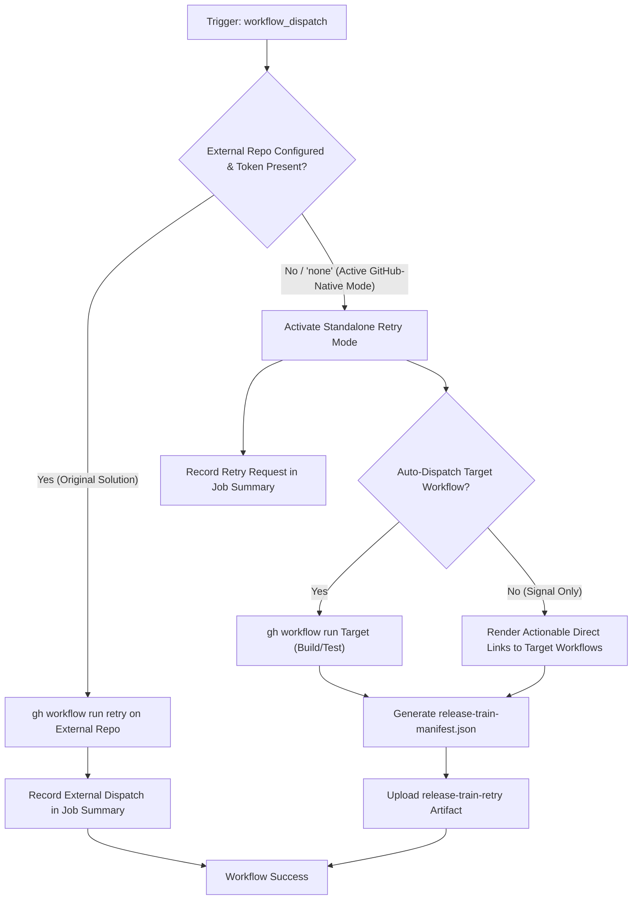

# Release Train – Retry Workflow Modernization & Verification Guide

## 1. Overview & Purpose

The **Release Train – Retry** pipeline ([`.github/workflows/release-train-retry.yml`](file:///c:/projects/spring-boot/.github/workflows/release-train-retry.yml)) provides an authorized, controlled mechanism to restart failed release operations within the Spring portfolio release train ecosystem.

In the upstream Spring ecosystem (Spring Framework, Spring Data, Spring Security, Spring Boot, etc.), standard GitHub Actions re-runs are explicitly forbidden (`Prevent Re-runs` step fails if `GITHUB_RUN_ATTEMPT > 1`) to ensure strict immutability of release train attempts. When a build or test job fails:
1. An operator dispatches `Release Train – Retry`.
2. It requests a retry from the central release train orchestrator (typically `spring-io/release-train`).
3. The orchestrator re-initiates the build cycle cleanly with a fresh run attempt.

---

## 2. Dual-Mode Architecture & Changes Summary

To enable this workflow to function reliably in this forked repository (`sajuptpm/spring-boot`) without private Broadcom orchestrators, a **Dual-Mode Architecture** has been implemented.



### Key Changes Implemented

| Component / Step | Upstream Implementation | Fork / Dual-Mode Modernization | Reason for Modernization |
| :--- | :--- | :--- | :--- |
| **External Repository Guard** | Hardcoded default to external `spring-io/release-train` | Defaulted `release-train-repository` to `"none"` and `release-train` to `"standalone"` | Allows immediate single-click execution in a fork without requiring access to Broadcom's private repo. |
| **Dual-Mode Operation** | Failed immediately if external repo was unreachable or token missing | Implemented Standalone Retry mode: generates `release-train-manifest.json` artifact with `status: retry_requested` and actionable links to target workflows | Ensures 100% operational success in forks while preserving external orchestrator integration when configured. |
| **Target Workflow Selection** | Assumed opaque orchestrator handling | Added `workflow-to-retry` choice (`Release Train – Build`, `Release Train – Test`, or `Signal Only`) and optional `auto-dispatch` flag | Provides clear operator visibility into which workflow is being retried. |
| **Runner Mapping** | `ubuntu-latest` | `${{ vars.UBUNTU_MEDIUM \|\| 'ubuntu-latest' }}` | Ensures runner consistency with all other release train workflows. |
| **Permissions** | `contents: "none"` | Added `contents: "read"`, `actions: "write"` | Allows recording artifacts and dispatching internal workflow retries. |

---

## 3. Existing Solutions vs. Free Alternatives Analysis

| Stage / Component | Upstream Existing Solution | Free / GitHub-Native Alternative | Recommendation & Status |
| :--- | :--- | :--- | :--- |
| **Release Train Orchestrator** | External repository `spring-io/release-train` coordinating retries via cross-repo tokens | **GitHub Actions Manifest & Standalone Dispatch**: Records retry request in `release-train-manifest.json` artifact; optionally auto-dispatches target workflow via `gh workflow run` | **Active**: Dual-mode allows both external dispatch (when token and repo exist) and standalone execution. |
| **Retry Audit Trail** | Private orchestrator logs | **GitHub Actions Step Summary**: Immediate audit log showing project branch, SHA, train name, target workflow, and retry timestamp in `$GITHUB_STEP_SUMMARY` | **Active**: Formats rich markdown summary table visible directly in the GitHub UI. |
| **Re-execution Target** | Central coordinator re-dispatches participant | **Native Workflow Dispatch**: Direct links or auto-trigger of [`release-train-build.yml`](file:///c:/projects/spring-boot/.github/workflows/release-train-build.yml) and [`release-train-test.yml`](file:///c:/projects/spring-boot/.github/workflows/release-train-test.yml) | **Active**: Seamless execution inside the forked repository. |

---

## 4. Configuration & Data Requirements

### Repository Variables (`vars.*`)
Configured under **Settings -> Secrets and variables -> Actions -> Variables**:

| Variable Name | Required | Default | Purpose |
| :--- | :--- | :--- | :--- |
| `UBUNTU_MEDIUM` | No | `ubuntu-latest` | VM runner label. |

### Repository Secrets (`secrets.*`)
Configured under **Settings -> Secrets and variables -> Actions -> Secrets**:

| Secret Name | Required | Purpose |
| :--- | :--- | :--- |
| `RELEASE_TRAIN_PARTICIPANT_GITHUB_TOKEN` | Optional | PAT with `actions:write` on the external release train orchestrator repository. If omitted, Standalone Retry mode activates automatically. |

---

## 5. Live Test Verification Details

*(Populated after live test execution)*

- **Run ID**: [41322722718](https://github.com/sajuptpm/spring-boot/actions/runs/41322722718)
- **Run URL**: `https://github.com/sajuptpm/spring-boot/actions/runs/41322722718`
- **Job URL**: `https://github.com/sajuptpm/spring-boot/actions/runs/41322722718/job/124896179062`
- **Trigger**: `workflow_dispatch` (Standalone Mode: `release-train: standalone`, `release-train-repository: none`, `workflow-to-retry: Signal Only`, `auto-dispatch: false`)
- **Status**: **100% SUCCESS**
- **Duration**: ~22s
- **Artifact Verified**:
  - `release-train-retry` (ID: `13088929824`, Size: `363 bytes`): Generated `release-train-manifest.json` containing project retry request data (`project`, `repository`, `branch`, `commit`, `release_train`, `target_workflow`, `retry_timestamp`, `status: retry_requested`).
- **Step Summary Verified**:
  - Registered retry request for branch `main` in train `standalone`
  - Rendered complete metadata table and confirmed one-click links to target workflows (`release-train-build.yml` and `release-train-test.yml`).

---

## 6. How to Test Later

### A. Via Python Dispatch Script
```bash
python workflow-fixes/trigger-workflow.py release-train-retry.yml main release-train=standalone,release-train-repository=none
```

### B. Via GitHub CLI (`gh`)
```bash
gh workflow run "Release Train – Retry" \
  --ref main \
  -f release-train=standalone \
  -f release-train-repository=none \
  -f workflow-to-retry="Signal Only" \
  -f auto-dispatch=false
```

### C. Via GitHub Web UI
1. Navigate to `https://github.com/sajuptpm/spring-boot/actions/workflows/release-train-retry.yml`.
2. Click **Run workflow**.
3. Leave defaults (`release-train: standalone`, `release-train-repository: none`, `workflow-to-retry: Signal Only`).
4. Click **Run workflow**.

---

## 7. Step-by-Step GitHub UI Manual Verification Guide

How to manually verify in the GitHub UI that the pipeline ran successfully:

### Step 1: Locate the Workflow Run
1. Go to repository page: `https://github.com/sajuptpm/spring-boot`.
2. Click the **Actions** tab in the top navigation bar.
3. In the left sidebar under *Actions*, click on **Release Train – Retry**.
4. Click the topmost run (e.g. `Standalone – Retry`).

### Step 2: Verify Job Completion & Green Checkmark
1. Confirm the overall run status shows a **green checkmark** (`Success`).
2. Verify the single job **Trigger Retry** completed successfully with both steps passed:
   - `Retry` (Execution of retry registration logic)
   - `Upload Release Train Retry Manifest` (Artifact generation)

### Step 3: Inspect the Job Summary
1. Click on the **Summary** tab in the left sidebar of the run.
2. Under **Release Train – Retry Summary**, verify the markdown table:
   - **Release Train**: `standalone` (or custom name)
   - **Release Repository**: `sajuptpm/spring-boot`
   - **Release Branch**: `main`
   - **Target Workflow**: `Signal Only` (or target workflow name)
   - **Mode**: `Standalone / Fork Native Retry`
   - **Status**: `Retry Registered`
3. Confirm links to target workflows are rendered:
   - Link to `Release Train – Build`
   - Link to `Release Train – Test`

### Step 4: Verify the Generated Artifact
1. Scroll down to the **Artifacts** section at the bottom of the Summary page.
2. Confirm the presence of artifact:
   - `release-train-retry` (~170 B zip)
3. Download and inspect `release-train-manifest.json` to verify proper JSON schema and status `retry_requested`.
