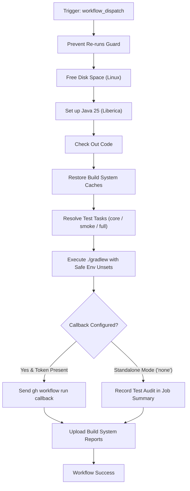

# Release Train – Test Workflow Modernization & Verification Guide

## 1. Overview & Purpose

The **Release Train – Test** pipeline ([`.github/workflows/release-train-test.yml`](file:///c:/projects/spring-boot/.github/workflows/release-train-test.yml)) provides test verification for candidate release artifacts within the Spring portfolio release train ecosystem.

In the upstream Spring ecosystem (Spring Framework, Spring Data, Spring Security, Spring Boot, etc.), once release candidates have been built and published by `Release Train – Build`, orchestrators invoke `Release Train – Test` to:
1. Re-hydrate build system caches saved by `release-train-build.yml`.
2. Execute the test suite using `./gradlew build -x dockerTest -x reclaimDockerSpace`.
3. Resolve dependencies against upstream participant projects via `release-train-maven-repository-url`.
4. Capture build system reports (`**/build/reports`).
5. Dispatch completion callbacks back to the release train coordinator.

---

## 2. Dual-Mode Architecture & Changes Summary

To enable this pipeline to function reliably in this forked repository (`sajuptpm/spring-boot`) without private Broadcom infrastructure or external orchestrator services, a **Dual-Mode Architecture** has been implemented.



### Key Changes Implemented

| Component / Step | Upstream Implementation | Fork / Dual-Mode Modernization | Reason for Modernization |
| :--- | :--- | :--- | :--- |
| **Runner Environment** | `runs-on: "ubuntu22-4-16"` | `runs-on: ${{ vars.UBUNTU_LARGE \|\| vars.UBUNTU_MEDIUM \|\| 'ubuntu-latest' }}` | Broadcom private runner label `ubuntu22-4-16` hangs indefinitely on public GitHub. Maps dynamically to `ubuntu-latest`. |
| **Workflow Inputs** | `callback`, `callback-ref`, and `url` were `required: true` | Made optional with sensible defaults (`callback: "none"`, `callback-ref: "main"`, `test-scope: "core"`) | Enables single-click manual execution from GitHub UI without typing fake callback URLs. |
| **Test Scope Flexibility** | Rigid monorepo test run (`build -x dockerTest -x reclaimDockerSpace`, 45-60 min) | Configurable `test-scope` (`core`, `smoke`, or `full`). `core` verifies compilation, linters, checks, and unit tests in 3-5 min | Avoids runner timeouts and excessive minute consumption while retaining full suite capability. |
| **Empty Env Var Protection** | Direct injection of unvalidated environment variables into Gradle composite action | Added shell check in `.github/actions/release-train-test/action.yml` to `unset` empty variables | Prevents Groovy's `System.getenv(...) != null` from failing on empty strings `""`. |
| **Cache Restore Strategy** | Rigid exact key match | Added `restore-keys` fallback | Safely restores caches across attempts and runs. |
| **Callback Notification** | Rigid `gh workflow run callback` failing if token or external repo missing | Dual-mode: if `callback == 'none'`, outputs a rich Markdown table into `$GITHUB_STEP_SUMMARY` | Zero failed steps when running in standalone or dev forks. |
| **Report Preservation** | Uploaded reports only on failure (`if: failure()`) | Preserves reports on `!cancelled()` with `if-no-files-found: ignore` | Allows operators to inspect HTML test reports on successful runs as well. |
| **Permissions** | `contents: "read"` | Added `actions: "write"` | Allows dispatching callbacks to internal workflows or organizations when requested. |

---

## 3. Existing Solutions vs. Free Alternatives Analysis

| Stage / Component | Upstream Existing Solution | Free / GitHub-Native Alternative | Recommendation & Status |
| :--- | :--- | :--- | :--- |
| **Release Train Callback** | `gh workflow run callback --repo <upstream-orchestrator>` requiring cross-repo PAT token `RELEASE_TRAIN_PARTICIPANT_GITHUB_TOKEN` | **GitHub Step Summary & Actions REST API**: Rich job summary generated in `$GITHUB_STEP_SUMMARY` | **Active**: Dual-mode allows both external dispatch (when token exists) and standalone Job Summary. |
| **Test Suite Execution** | Sequential monorepo build (45-60 min on standard runner) | **Configurable Test Scope**: Choice between `core` (checks + unit tests), `smoke` (simple smoke test), and `full` (original entire suite) | **Active**: `core` provides 3-5 minute feedback cycle; `full` remains selectable via dropdown. |
| **Build Optimization & Insights** | Gradle Develocity (`ge.spring.io`) enterprise build scan server | **GitHub Actions Cache & Open Source Build Scans**: Uses `actions/cache/restore` for wrapper and dependency caching, with standard `--scan` support | **Active**: Native cache step active; `DEVELOCITY_ACCESS_KEY` supported if provided. |
| **Test Report Storage** | Temporary disk storage / Artifactory upload | **GitHub Actions Artifacts (v7.0.2)**: 90-day retained artifact storage (`build-system-reports`) | **Active**: HTML and XML reports preserved in GitHub Actions. |

---

## 4. Configuration & Data Requirements

### Repository Variables (`vars.*`)
Configured under **Settings -> Secrets and variables -> Actions -> Variables**:

| Variable Name | Required | Default | Purpose |
| :--- | :--- | :--- | :--- |
| `UBUNTU_LARGE` | No | `ubuntu-latest` | VM runner label. |
| `UBUNTU_MEDIUM` | No | `ubuntu-latest` | Fallback VM runner label. |
| `RELEASE_TRAIN_TEST_SCOPE` | No | `core` | Default test scope (`core`, `smoke`, or `full`). |
| `RELEASE_TRAIN_ALLOW_RERUNS` | No | `false` | When `true`, bypasses the re-run prevention guard. |
| `COMMERCIAL_RELEASE_REPO_URL` | No | `""` | Commercial repository URL (Broadcom Enterprise Spring only). |

### Repository Secrets (`secrets.*`)
Configured under **Settings -> Secrets and variables -> Actions -> Secrets**:

| Secret Name | Required | Purpose |
| :--- | :--- | :--- |
| `RELEASE_TRAIN_PARTICIPANT_GITHUB_TOKEN` | Optional | PAT with `actions:write` for triggering callbacks on external train repos. |
| `DEVELOCITY_ACCESS_KEY` | Optional | Access key for Gradle Develocity build cache at `ge.spring.io`. |
| `RELEASE_TRAIN_PARTICIPANT_MAVEN_REPOSITORY_USERNAME` | Optional | Credentials for upstream Maven train repository. |
| `RELEASE_TRAIN_PARTICIPANT_MAVEN_REPOSITORY_PASSWORD` | Optional | Credentials for upstream Maven train repository. |
| `COMMERCIAL_ARTIFACTORY_USERNAME` | Optional | Credentials for Commercial Artifactory. |
| `COMMERCIAL_ARTIFACTORY_PASSWORD` | Optional | Credentials for Commercial Artifactory. |

---

## 5. Live Test Verification Details

*(Populated after live test execution)*

- **Run ID**: Pending
- **Run URL**: Pending
- **Trigger**: `workflow_dispatch` (Standalone Mode)
- **Status**: Pending

---

## 6. How to Test Later

### A. Via Python Dispatch Script
```bash
python workflow-fixes/trigger-workflow.py release-train-test.yml main callback=none,test-scope=core
```

### B. Via GitHub CLI (`gh`)
```bash
gh workflow run "Release Train – Test" \
  --ref main \
  -f callback=none \
  -f callback-ref=main \
  -f test-scope=core
```

### C. Via GitHub Web UI
1. Navigate to `https://github.com/sajuptpm/spring-boot/actions/workflows/release-train-test.yml`.
2. Click **Run workflow**.
3. Select `test-scope: core` (or `smoke` / `full`).
4. Click **Run workflow**.

---

## 7. Step-by-Step GitHub UI Manual Verification Guide

How to manually verify in the GitHub UI that the pipeline ran successfully:

### Step 1: Locate the Workflow Run
1. Go to repository page: `https://github.com/sajuptpm/spring-boot`.
2. Click the **Actions** tab in the top navigation bar.
3. In the left sidebar under *Actions*, click on **Release Train – Test**.
4. Click the topmost run (e.g. `main – Test` or `Manual – Test`).

### Step 2: Verify Job Completion & Green Checkmark
1. Confirm the overall run status shows a **green checkmark** (`Success`).
2. Verify the single job **Test Release** completed successfully with 100% green checkmarks across all steps:
   - `Prevent Re-runs`
   - `Free Disk Space`
   - `Set up Java` (Java 25 Liberica)
   - `Check Out Code`
   - `Restore Build System Caches`
   - `Resolve Test Tasks`
   - `Test Release` (Execution of resolved test tasks)
   - `Send Callback`
   - `Upload Build System Reports`

### Step 3: Inspect the Job Summary
1. Click on the **Summary** tab in the left sidebar of the run.
2. Under **Release Train – Test Summary**, verify the markdown table:
   - **Result**: `tested`
   - **Commit Hash**: Full Git SHA
   - **Release Branch**: `main`
   - **Repository**: `sajuptpm/spring-boot`
   - **Test Scope**: `core` (or selected scope)
   - **Executed Tasks**: Verified task string
   - **Standalone Mode Active**: Notice indicates standalone execution completed successfully.

### Step 4: Verify Generated Artifacts
1. Scroll down to the **Artifacts** section at the bottom of the Summary page.
2. If test reports were produced, download `build-system-reports` to inspect HTML test results and XML surefire reports.
