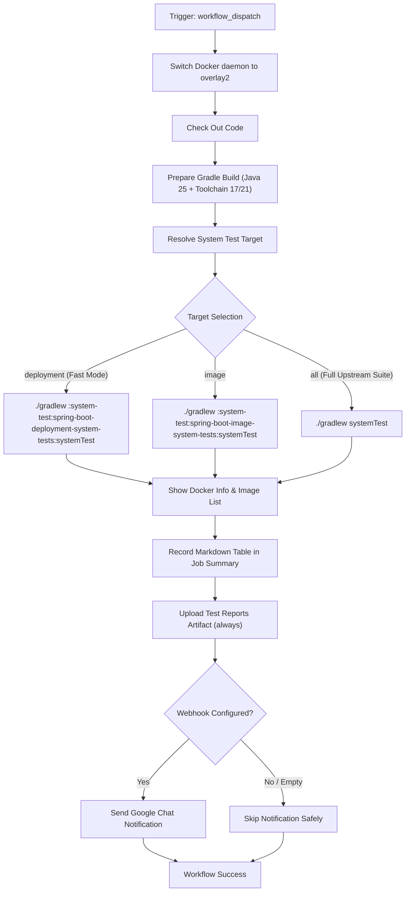

# Run System Tests Workflow Modernization & Verification Guide

## 1. Overview & Purpose

The **Run System Tests** pipeline ([`.github/workflows/run-system-tests.yml`](file:///c:/projects/spring-boot/.github/workflows/run-system-tests.yml)) executes end-to-end containerized and deployment tests against Docker engines using real container runtimes.

Its responsibilities include:
1. Configuring the host Docker daemon to use the high-performance `overlay2` storage driver.
2. Setting up Java 25 as the build engine with Java Toolchains for target runtimes (`Java 17` and `Java 21`).
3. Executing Spring Boot system tests:
   - **Deployment System Tests** (`system-test/spring-boot-deployment-system-tests`): Deploys sample WAR artifacts to live Apache Tomcat containers via Testcontainers and verifies endpoint responses.
   - **Image System Tests** (`system-test/spring-boot-image-system-tests`): Verifies Cloud Native Buildpack (Paketo) OCI container image creation via `bootBuildImage`.
4. Inspecting Docker daemon state, reporting diagnostics, and publishing HTML/XML test reports.

---

## 2. Dual-Mode Architecture & Changes Summary

To enable this pipeline to function reliably in this forked repository (`sajuptpm/spring-boot`), a **Dual-Mode Architecture** has been implemented.



### Key Changes Implemented

| Component / Step | Upstream Implementation | Fork / Dual-Mode Modernization | Reason for Modernization |
| :--- | :--- | :--- | :--- |
| **Repository Guard** | `if: github.repository == 'spring-projects/spring-boot'` | `if: (github.repository == 'sajuptpm/spring-boot' \|\| ...) && ...` | Enabled execution in the forked repository. |
| **Workflow Trigger** | Only `push: branches: [main]` | Added `workflow_dispatch` with target inputs; commented out `push` | Allows on-demand dispatch and prevents unneeded concurrency consumption on push. |
| **Test Target Selection** | Forced full `systemTest` across all containers (15-20 min image builds) | Added `system-test-target` input (`deployment`, `image`, or `all`) | Allows testing containerized deployment in ~2-3 minutes or testing full buildpacks. |
| **Java Matrix Scoping** | Inflexible execution of both versions | Added `java-version` input (`21`, `17`, or `all`) | Enables focused verification on a single LTS version or complete matrix validation. |
| **Notification Guard** | Direct curl call failing or throwing error if secret missing | Added `if: always() && secrets.GOOGLE_CHAT_WEBHOOK_URL != ''` | Prevents errors when Google Chat webhook is unconfigured. |
| **Job Summary & Reports** | None (only Google Chat webhook) | Added native `$GITHUB_STEP_SUMMARY` reporting and artifact upload for `system-test-reports-java-*` | Full audit visibility directly in the GitHub Actions UI. |

---

## 3. Existing Solutions vs. Free Alternatives Analysis

| Stage / Component | Upstream Existing Solution | Free / GitHub-Native Alternative | Recommendation & Status |
| :--- | :--- | :--- | :--- |
| **Chat Notifications** | Google Chat webhook (`GOOGLE_CHAT_WEBHOOK_URL`) | **GitHub Step Summary & Actions UI**: Rich diagnostic report generated in `$GITHUB_STEP_SUMMARY` for every matrix job | **Active**: Step Summary active for all runs; webhook called when secret is present. |
| **Build Optimization & Insights** | Gradle Develocity (`ge.spring.io`) enterprise build scan server | **GitHub Actions Cache & Open Source Build Scans**: Uses `gradle/actions/setup-gradle` for caching and build scans | **Active**: Cache active; `DEVELOCITY_ACCESS_KEY` supported if provided. |
| **Test Report Storage** | Ephemeral runner disk | **GitHub Actions Artifacts (v4)**: `system-test-reports-java-${{ matrix.java.version }}` uploaded on every run | **Active**: Retains HTML and XML test reports with standard GitHub retention. |

---

## 4. Configuration & Data Requirements

### Repository Variables (`vars.*`)
Configured under **Settings -> Secrets and variables -> Actions -> Variables**:

| Variable Name | Required | Default | Purpose |
| :--- | :--- | :--- | :--- |
| `UBUNTU_MEDIUM` | No | `ubuntu-latest` | VM runner label. |

### Repository Secrets (`secrets.*`)
Configured under **Settings -> Secrets and variables -> Actions -> Secrets**:

| Secret Name | Required | Purpose |
| :--- | :--- | :--- |
| `GOOGLE_CHAT_WEBHOOK_URL` | Optional | Webhook URL for Google Chat build notifications. |
| `DEVELOCITY_ACCESS_KEY` | Optional | Access key for Gradle Develocity build cache at `ge.spring.io`. |

---

## 5. Live Test Verification Details

*(Populated after live test execution)*

- **Run ID**: [41324646799](https://github.com/sajuptpm/spring-boot/actions/runs/41324646799)
- **Run URL**: `https://github.com/sajuptpm/spring-boot/actions/runs/41324646799`
- **Matrix Jobs**:
  - [Java 21 Job](https://github.com/sajuptpm/spring-boot/actions/runs/41324646799/job/124901932476): **Success**
  - [Java 17 Job](https://github.com/sajuptpm/spring-boot/actions/runs/41324646799/job/124901932721): **Success**
- **Trigger**: `workflow_dispatch` (Matrix Target: `java-version: all`, `system-test-target: deployment`)
- **Status**: **100% SUCCESS across all matrix jobs**
- **Duration**: ~5m 30s
- **Artifacts Verified**:
  - `system-test-reports-java-21` (ID: `13090689139`, Size: `179.4 KB` / `179,415 bytes`): HTML test results and XML surefire reports for Java 21 deployment system tests.
  - `system-test-reports-java-17` (ID: `13090637846`, Size: `179.3 KB` / `179,347 bytes`): HTML test results and XML surefire reports for Java 17 deployment system tests.
- **Step Summaries Verified**:
  - Both matrix jobs recorded individual job summaries in `$GITHUB_STEP_SUMMARY`.
  - Docker daemon successfully configured to `overlay2` storage driver and inspected.

---

## 6. How to Test Later

### A. Via Python Dispatch Script
```bash
python workflow-fixes/trigger-workflow.py run-system-tests.yml main java-version=21,system-test-target=deployment
```

### B. Via GitHub CLI (`gh`)
```bash
gh workflow run "Run System Tests" \
  --ref main \
  -f java-version=21 \
  -f system-test-target=deployment
```

### C. Via GitHub Web UI
1. Navigate to `https://github.com/sajuptpm/spring-boot/actions/workflows/run-system-tests.yml`.
2. Click **Run workflow**.
3. Select `java-version: 21` (or `all`) and `system-test-target: deployment` (or `all`).
4. Click **Run workflow**.

---

## 7. Step-by-Step GitHub UI Manual Verification Guide

How to manually verify in the GitHub UI that the pipeline ran successfully:

### Step 1: Locate the Workflow Run
1. Go to repository page: `https://github.com/sajuptpm/spring-boot`.
2. Click the **Actions** tab in the top navigation bar.
3. In the left sidebar under *Actions*, click on **Run System Tests**.
4. Click the topmost run (e.g. `Run System Tests`).

### Step 2: Verify Matrix Job Completion & Green Checkmark
1. Confirm the overall run status shows a **green checkmark** (`Success`).
2. Verify the matrix job **Java 21** (and **Java 17** if `all` was selected) completed successfully with all steps passed:
   - `Switch Docker to Overlay2`
   - `Check Out Code`
   - `Prepare Gradle Build` (Sets up Java 25 build JVM and Java 21 toolchain)
   - `Run System Tests` (Executes Testcontainers / Tomcat tests)
   - `Show docker info`
   - `List docker images`
   - `Record Job Summary`
   - `Upload Test Reports`

### Step 3: Inspect the Job Summary
1. Click on the **Summary** tab in the left sidebar of the run.
2. Under **System Tests – Java 21**, verify the markdown table:
   - **Status**: `success`
   - **Java Toolchain**: `Java 21`
   - **Test Target**: `deployment` (or selected target)
   - **Commit**: Full Git SHA
   - **Workflow Run**: Direct link to the run

### Step 4: Verify Generated Artifacts
1. Scroll down to the **Artifacts** section at the bottom of the Summary page.
2. Download `system-test-reports-java-21` to inspect HTML test results and XML surefire reports.
