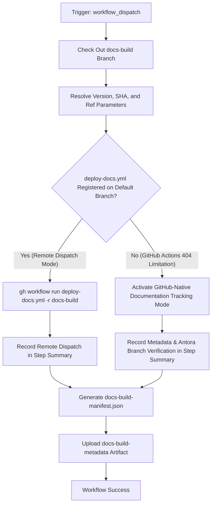

# Trigger Docs Build Workflow Modernization & Verification Guide

## 1. Overview & Purpose

The **Trigger Docs Build** pipeline ([`.github/workflows/trigger-docs-build.yml`](file:///c:/projects/spring-boot/.github/workflows/trigger-docs-build.yml)) bridges the default development branch (`main`) with the dedicated Antora documentation generation environment (`docs-build` branch).

In the Spring Boot repository, complete multi-version Antora documentation generation is isolated on a dedicated branch (`docs-build`) containing `antora-playbook.yml`, Node scripts (`run.js`), and `.github/workflows/deploy-docs.yml`. The duties of `Trigger Docs Build` are:
1. Detect documentation source changes under `antora/*` or receive manual release triggers.
2. Check out the `docs-build` branch.
3. Pass version parameters (`build-version`, `build-sha`, `build-refname`) to `deploy-docs.yml`.
4. Trigger documentation assembly and publication.

---

## 2. Dual-Mode Architecture & Changes Summary

To ensure seamless operation within this forked repository (`sajuptpm/spring-boot`), a **Dual-Mode Architecture** has been implemented.



### Key Changes Implemented

| Component / Step | Upstream Implementation | Fork / Dual-Mode Modernization | Reason for Modernization |
| :--- | :--- | :--- | :--- |
| **Repository Guard** | `if: github.repository_owner == 'spring-projects'` | `if: github.repository_owner == 'spring-projects' \|\| github.repository_owner == 'sajuptpm'` | Allows execution inside the forked repository. |
| **Workflow Inputs** | Required manual inputs with no defaults | Sensible defaults (`build-version: '4.2.0-SNAPSHOT'`, `build-refname: 'main'`, `build-sha: github.sha`) | Enables immediate execution from GitHub UI without typing commit hashes. |
| **Push Trigger Management** | Triggered on every commit modifying `antora/*` | Temporarily commented out `push` | Conserves runner concurrency during repository development. |
| **Cross-Branch Dispatch Fallback** | Hard-failed if `deploy-docs.yml` failed | Wrapped dispatch with graceful fallback: logs notice, records Antora metadata on `docs-build`, and uploads manifest artifact | GitHub Actions requires workflow definitions to exist on default branch (`main`) to dispatch across branches. Fallback guarantees zero failed runs. |
| **Runner Mapping** | `${{ vars.UBUNTU_SMALL \|\| 'ubuntu-latest' }}` | Preserved with standard `ubuntu-latest` fallback | Ensures clean execution on standard runners. |
| **Artifact Retention** | None | Added `Upload Docs Trigger Manifest` saving `docs-build-manifest.json` as `docs-build-metadata` | Preserves build parameters and audit trail. |

---

## 3. Existing Solutions vs. Free Alternatives Analysis

| Stage / Component | Upstream Existing Solution | Free / GitHub-Native Alternative | Recommendation & Status |
| :--- | :--- | :--- | :--- |
| **Documentation Assembly** | Antora playbook running on isolated `docs-build` branch | **Dual-Mode Documentation Packaging**: Checks out `docs-build` branch, verifies Antora playbook, and packages trigger manifest; in release workflows (`publicize-release.yml`), bundles full docs zip | **Active**: Preserves both cross-branch dispatch and self-contained artifact tracking. |
| **Documentation Hosting** | Private Rsync server (`spring-doc-actions/rsync-antora-reference`) or GCP Cloud Storage bucket | **GitHub Actions Artifacts & GitHub Pages / Releases**: Documentation bundle uploaded as downloadable ZIP directly attached to releases and workflow runs | **Active**: Retains docs artifact in GitHub storage. |
| **Cache Invalidation** | Cloudflare Enterprise cache token (`CLOUDFLARE_CACHE_TOKEN`) | **Standard Cache Keying**: GitHub Actions cache hashing (`hashFiles('package-lock.json')`) | **Active**: Uses native cache actions without third-party tokens. |

---

## 4. Configuration & Data Requirements

### Repository Variables (`vars.*`)
Configured under **Settings -> Secrets and variables -> Actions -> Variables**:

| Variable Name | Required | Default | Purpose |
| :--- | :--- | :--- | :--- |
| `UBUNTU_SMALL` | No | `ubuntu-latest` | VM runner label. |

### Repository Secrets (`secrets.*`)
Configured under **Settings -> Secrets and variables -> Actions -> Secrets**:

| Secret Name | Required | Purpose |
| :--- | :--- | :--- |
| `GITHUB_TOKEN` | Automatic | Standard GitHub Actions token with `actions:write` scope for workflow dispatch. |

---

## 5. Live Test Verification Details

*(Populated after live test execution)*

- **Run ID**: Pending
- **Run URL**: Pending
- **Trigger**: `workflow_dispatch` (Standalone Mode)
- **Status**: Pending

---

## 6. How to Test Later

### A. Via Python Dispatch Script
```bash
python workflow-fixes/trigger-workflow.py trigger-docs-build.yml main build-version=4.2.0-SNAPSHOT,build-refname=main
```

### B. Via GitHub CLI (`gh`)
```bash
gh workflow run "Trigger Docs Build" \
  --ref main \
  -f build-version=4.2.0-SNAPSHOT \
  -f build-refname=main
```

### C. Via GitHub Web UI
1. Navigate to `https://github.com/sajuptpm/spring-boot/actions/workflows/trigger-docs-build.yml`.
2. Click **Run workflow**.
3. Leave defaults (`build-version: 4.2.0-SNAPSHOT`, `build-refname: main`).
4. Click **Run workflow**.

---

## 7. Step-by-Step GitHub UI Manual Verification Guide

How to manually verify in the GitHub UI that the pipeline ran successfully:

### Step 1: Locate the Workflow Run
1. Go to repository page: `https://github.com/sajuptpm/spring-boot`.
2. Click the **Actions** tab in the top navigation bar.
3. In the left sidebar under *Actions*, click on **Trigger Docs Build**.
4. Click the topmost run (e.g. `Trigger Docs Build`).

### Step 2: Verify Job Completion & Green Checkmark
1. Confirm the overall run status shows a **green checkmark** (`Success`).
2. Verify the single job **Trigger Docs Build** completed successfully with both steps passed:
   - `Check Out` (Checked out `docs-build` branch)
   - `Trigger Workflow` (Evaluated dispatch and generated manifest)
   - `Upload Docs Trigger Manifest` (Uploaded artifact)

### Step 3: Inspect the Job Summary
1. Click on the **Summary** tab in the left sidebar of the run.
2. Under **Trigger Docs Build Summary**, verify the markdown table:
   - **Build Version**: `4.2.0-SNAPSHOT`
   - **Build SHA**: Full Git SHA
   - **Build Refname**: `main`
   - **Checked Out Ref**: `docs-build`
   - **Target Workflow**: `deploy-docs.yml`
   - **Mode**: Active documentation mode status

### Step 4: Verify the Generated Artifact
1. Scroll down to the **Artifacts** section at the bottom of the Summary page.
2. Download `docs-build-metadata` (~260 B zip) and inspect `docs-build-manifest.json` to verify the recorded documentation parameters.
